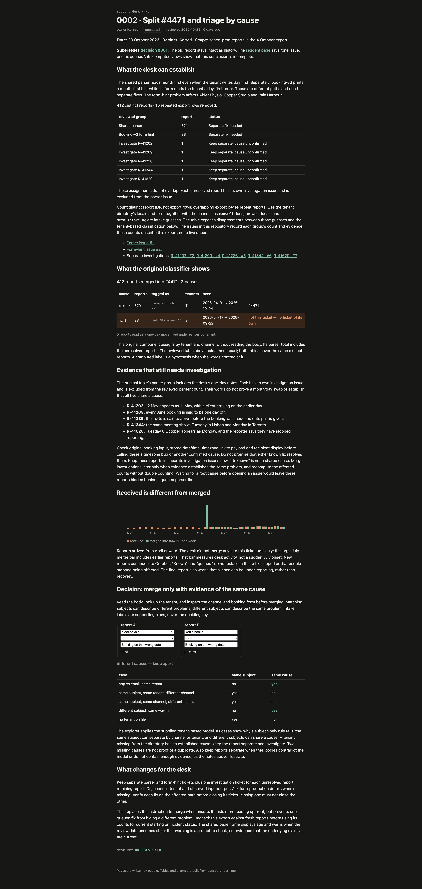

# S01E03 — what it shows

Split the support desk's #4471 by evidence, including separate investigations where a cause is not established.

| Issue | Assignment | Distinct reports |
| --- | --- | ---: |
| [#1](https://github.com/Korred/mega-dev-tasks/issues/1) | Shared month-first parser | 374 |
| [#2](https://github.com/Korred/mega-dev-tasks/issues/2) | Booking-v3 form hint | 33 |
| [#3](https://github.com/Korred/mega-dev-tasks/issues/3) | R-41202: invite/calendar one-day disagreement | 1 |
| [#4](https://github.com/Korred/mega-dev-tasks/issues/4) | R-41209: June-only one-day shifts | 1 |
| [#5](https://github.com/Korred/mega-dev-tasks/issues/5) | R-41236: invite reportedly arrives before booking | 1 |
| [#6](https://github.com/Korred/mega-dev-tasks/issues/6) | R-41344: recipients in different cities see different days | 1 |
| [#7](https://github.com/Korred/mega-dev-tasks/issues/7) | R-41620: Tuesday shows as Monday | 1 |
| Total | Every distinct report assigned once | 412 |

The export contains 427 rows; 15 repeat report IDs. The original classifier returns 379 parser
and 33 hint reports. Five bodies do not establish the classifier's parser assignment. They are
held apart for investigation, leaving 374 in the parser issue. These investigations are separate
because uncertainty alone does not establish a common problem. They can be merged if later
evidence supports a shared cause. Counts describe the 4 October export, not a live support queue.

## Deliverables

- [Signed kb decision source](support-kb/src/routes/kb/decisions/0002-triage-by-cause/+page.svx).
- [Rendered page screenshot](rendered/0002-triage-by-cause.png): the complete page, captured in Edge.
- [Standalone rendered HTML](rendered/0002-triage-by-cause.html): download and open in a browser. This is a frozen snapshot with inline styles; explorer controls are disabled. Use the app below for interaction.
- [Rendered text](rendered/0002-triage-by-cause.txt): accessible, searchable text extracted from that browser render.
- [Complete report assignments](report-assignments.json): report IDs and count for every issue.
- [Issue body copies](issues/).
- [Interactive kb source](support-kb/): run the app below to use its explorer and navigate the kb.

The new decision supersedes decision 0001 without editing that historical record. Current
triage guidance and the incident page link to the review so they no longer instruct the desk
to merge on subject or assume one queued fix covers everything. Original classifier and timeline
components are preserved; the new reviewed table makes the evidence-based exceptions visible.

The signature is the course-issued page signature, included in frontmatter as required. The
rendered page ends in the derived desk reference `DR-03E5-9X18`.

## Reproduce

Requires Node.js 24 or newer and npm.

```sh
cd S01E03/support-kb
npm ci
npm run check
npm run build
npm run dev
```

Open the local URL printed by Vite. The default page is the new decision; `/kb` opens the index.
To view the production build after `npm run build`, run `npm exec vite preview -- --host 127.0.0.1` in the same directory.

The runnable check verifies unique IDs, the original classification, the reviewed partition,
the complete assignment manifest, intake-tag disagreements, missing-tenant handling, dedupe
examples, the receipt/merge timeline distinction and the page's signature-derived reference.
The browser check also verified that changing a tenant changes the explorer verdict, while
changing a subject alone does not. This verifies the kb; no running product was supplied for
reproducing the reported scheduling defects.


